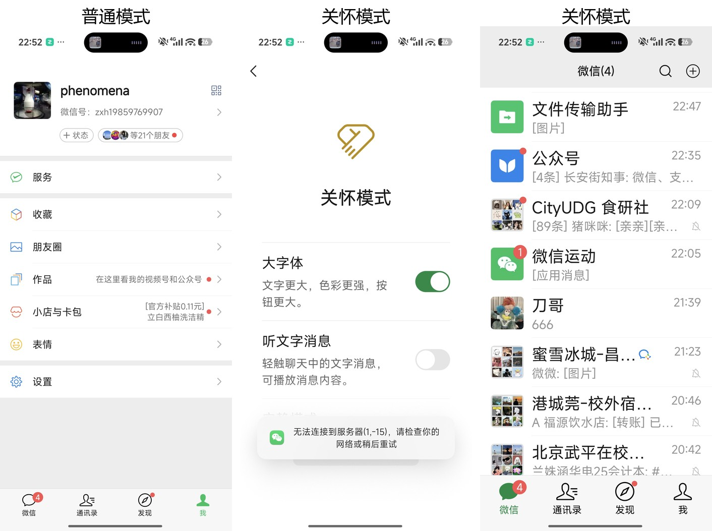
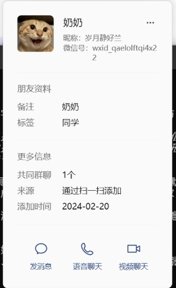

# 一部智能手机进入我家：老年数字参与的变迁与适老化政策的运行机制

**摘要**：本文以奶奶使用智能手机的变迁为案例，研究智能化普及为什么一度提高了老年人的办事成本，以及2020年以来的适老化政策通过哪些环节改变了老年人的数字参与。研究发现，变化由接入改善、政策回应、企业改造与家庭反哺共同促成，但老年人的数字参与仍呈选择性与依赖性，印证了社会主要矛盾在微观生活领域的存在。

**关键词**：数字鸿沟；适老化改造；社会主要矛盾；文化反哺；以人民为中心

## 一、问题提出

大约从2020年起，教奶奶用手机成了家里反复出现的事。健康码、扫码付款、视频通话、抖音，每一项新事物进门，都要先过"奶奶会不会用"这一关。由此形成本文的研究问题：智能化普及为什么在提高家庭整体办事效率的同时，一度提高了老年人的办事成本？2020年以来的适老化政策通过哪些环节改变了老年人的数字参与？这种改变在家庭内部存在哪些差异和限度？

这个问题具有分析价值：它追问代价的代际分配与制度的回应方式；案例虽小，却一头连着数字经济与技术扩散，一头连着老龄社会治理，能与课程中社会主要矛盾、以人民为中心的发展思想等理论建立直接联系；家庭三代人的差异还提供了天然对照——同样的环境下，数字参与为什么分层。

## 二、案例与材料

案例主角是奶奶，1951年生，福建西部某山区县人，小学文化，长期在镇村生活。比较对象是我的母亲（1975年生）和我本人（在读研究生）。我于2026年国庆假期回家，对奶奶和母亲各做约四十分钟半结构式访谈，并当场核对了奶奶手机的设置与使用记录。

本文使用三类材料。生活资料两项：微信"关怀模式"开启前后的界面截图（图1）；更换后的网络图片头像（图2）。政策资料以国务院办公厅2020年11月印发的《关于切实解决老年人运用智能技术困难的实施方案》（国办发〔2020〕45号）为核心，辅以配套政策；辅助资料为CNNIC《中国互联网络发展状况统计报告》的老年网民数据，及周晓虹、邱泽奇等学者的两篇文献。

## 三、变化的具体表现

**（一）按键机时代（约2017—2019年）**

奶奶用按键式老人机，只接打电话。与之办事走的是线下渠道：缴电费去镇上营业厅，看病由家人凌晨去县医院排队挂号，与外地子女联系靠长途电话，孙辈照片要等人冲洗寄回。每件事都慢，却都有她熟悉的线下渠道，可谓"慢而不难"。

**（二）数字冲击（2020—2021年）**

疫情防控期间，健康码成为出行就医的通行证，扫码成为默认支付方式。奶奶两次明显受阻：因不会出示健康码被公交司机劝返，在医院自助机前不会操作只能等家人赶到。母亲回忆，那段时间"办任何事都要先想一下老人怎么办"。同一时期，数字化显著提高了家庭整体效率——我和母亲挂号、缴费、购物几乎不再跑腿——却把奶奶推到了服务门外。

**（三）重建参与（2022—2026年）**

家人为奶奶更换了智能手机。她如今每天与子女视频通话、收发微信语音、小额扫码付款、给家人拍照，微信开启了"关怀模式"（大字体、简化界面，图1）。

<b>图1 微信"关怀模式"开启前后对比（左起：普通模式、关怀模式）</b>

我帮她挑了一张网络图片，换掉了微信默认的灰色人形头像——家人在群里一眼就能认出她（图2）。

<b>图2 更换后的网络图片头像</b>

就医方面，县医院保留人工窗口与电话挂号，流程是"母亲手机代挂号、奶奶凭身份证取号"，医保码也由母亲代办；网约车、政务App等事项她仍不能独立完成，网购仅限于"看直播让女儿下单"。

变化最大的是刷抖音。2023年寒假，我用两个下午教会奶奶：调大字号，认首页、搜索和转发。她起初看电视剧剪辑片段，近来迷上了夸张演绎的短剧，午睡后固定刷半小时，把好看的视频转到家庭群。短剧看到一半要付费解锁，她常问我们"为什么看不了了"；我教她点进发布账号主页看更多、还能选集。

三代人比较显示：我属于"无感使用"，母亲属于"学了就会、会了就教"，奶奶属于"选择性使用、依赖性参与"。同一环境下，数字参与出现了清晰的代际分层。

## 四、变化的形成机制

奶奶的变化不是单一因素造成的，至少有五个环节先后发生作用。

第一，接入条件普及先行。智能手机降价与农村网络覆盖，使"用不用得起"在2020年前后基本解决，对应数字鸿沟研究中"接入沟"缩小的判断（邱泽奇等，2016）。

第二，疫情造成"强制数字化"冲击。健康码把数字能力变成出行准入门槛，线下渠道收缩，老年人办事成本骤增。类似个案经媒体进入舆论，构成政策议程的触发条件。

第三，政策自上而下回应，形成逐级升格的制度阶梯。2020年11月，国务院办公厅印发《关于切实解决老年人运用智能技术困难的实施方案》（国办发〔2020〕45号），聚焦出行、就医、消费等高频事项提出二十条举措，核心原则是传统服务与智能化服务"并行"，线上不能取消线下兜底。2020年12月，工信部部署《互联网应用适老化及无障碍改造专项行动方案》，首批推动115家网站和43个常用App改造。2023年6月28日，全国人大常委会通过《无障碍环境建设法》，9月1日施行，将老年人明确纳入保障对象，专章规定无障碍信息交流，适老化由此上升为法律义务。

第四，企业供给侧响应。政策强制与社会评价双重激励下，常用App陆续上线大字体、简化流程的"关怀模式"，奶奶能"看得见、点得动"，直接受益于此。

第五，家庭内部的文化反哺。周晓虹（2000）把急速变迁社会中晚辈向长辈传授文化称为"文化反哺"。在我家，反哺既有接力的——我教母亲，母亲再教奶奶；也有隔代直达的——我假期教会奶奶刷抖音。家庭微信群是练习场，假期面授与视频"远程指导"是主要教学方式。缺了这一环，制度供给变不成使用能力。

据CNNIC统计，老年群体互联网普及率由2021年12月的43.2%升至2024年12月的52.5%，印证了五个环节的耦合——接入、能力、制度条件同时改善，缺一不可。

## 五、课程理论分析

**（一）社会主要矛盾的转化：分析变化性质的主要工具**

中国特色社会主义进入新时代，社会主要矛盾转化为人民日益增长的美好生活需要和不平衡不充分的发展之间的矛盾。本案例是这一判断的微观注脚。2020年前后奶奶的困境并非发展不足所致，而是发展"快而不均"：智能化供给领先于老年人的能力积累与制度保障，发展成果的分配出现不平衡。老年人的需要也已从"用得上"扩展为"用得了、用得安心"，这正是"美好生活需要"的具体内容。适老化政策所处理的正是矛盾中"不平衡不充分"的一侧：不是放慢发展，而是补齐短板。矛盾分析由此把"奶奶办事难"的感受，转写为"发展成果共享机制存在缺口"的可分析命题。

**（二）以人民为中心的发展思想：解释制度回应取向的辅助工具**

面对老年人的数字困境，制度上可选全面数字化、维持传统或两者并行。国办发〔2020〕45号选择"并行"与"兜底"，把保留线下渠道、允许亲属代办作为刚性要求。以人民为中心的发展思想可以解释：技术进步的评判标准不是单一效率，而是人的获得感；发展手段不能反过来成为一部分人参与社会的障碍。共享发展理念进一步指明数字红利的分配方向，与邱泽奇等（2016）的"红利差异"问题相呼应——制度回应的目标，正是缩小由能力差异导致的红利差异。这一价值取向经由"部署—改造—立法"落地为可执行规则，说明以人民为中心并非宣示性表述，而是有政策工具支撑的治理逻辑。

**（三）理论意义**

本案例同时呈现矛盾的生成与化解，说明社会主要矛盾的转化能在家庭层面被观察检验，也提示家庭是政策落地的"最后一米"。

## 六、影响、矛盾与限度

第一，代际感受分化。对奶奶而言，视频通话和刷抖音最受珍视，"每天能看见人"提高了她的生活满意度；母亲最看重挂号与医保代办的省心；我则几乎没有感知到政策的存在——受益者往往最少谈论政策。

第二，新形态的风险与依赖。奶奶会看、会聊、会小额支付，但风险判断能力没有同步增长。家人最担心短剧平台的诱导充值与冒充客服的电信诈骗，母亲因此定期检查她的支付限额与应用权限。此外，奶奶的关键事务多数仍靠子女代办，这既是便民安排，也构成新的依赖：代办人不在场，问题立即回到原点。同一操作往往要教五遍以上。

第三，案例的代表性边界。本案例是"有子女可依赖、家庭关系紧密"的老年样本。据CNNIC第55次报告，截至2024年12月，60岁及以上群体互联网普及率为52.5%，且该群体占非网民总数的46.8%；独居、农村、低教育程度的老年人处境与奶奶并不相同。一个家庭的经验不能推论社会整体，本文只论证机制的存在，不主张效果普遍。

## 七、结论

回答可概括为三点。第一，智能化初期老年人成本上升，源于接入先行而能力建设与制度保障滞后，疫情将这一时间差集中放大。第二，改变依赖三类机制的耦合：政策以"并行兜底"自上而下回应，企业按适老化标准改造供给，家庭以文化反哺传递能力，宏观上对应老年群体互联网普及率三年提高约九个百分点。第三，改变存在限度：老年人的数字参与呈选择性与依赖性，风险形式从"进不去"转为"看不住"。就理论而言，社会主要矛盾的转化可以在家庭生活中被具体观察，以人民为中心的发展思想能够解释"要效率、也要兜底"的制度取向。

## 参考资料

1. 国务院办公厅：《关于切实解决老年人运用智能技术困难的实施方案》（国办发〔2020〕45号），2020年11月印发。
2. 工业和信息化部：《互联网应用适老化及无障碍改造专项行动方案》，2020年12月印发。
3. 《中华人民共和国无障碍环境建设法》，第十四届全国人大常委会第三次会议2023年6月28日通过，2023年9月1日施行。
4. 中国互联网络信息中心（CNNIC）：《第49次〈中国互联网络发展状况统计报告〉》（2022年2月发布）；《第55次〈中国互联网络发展状况统计报告〉》（2025年1月发布）。
5. 周晓虹：《文化反哺：变迁社会中的亲子传承》，《社会学研究》2000年第2期。
6. 邱泽奇、张樹沁、刘世定、许英康：《从数字鸿沟到红利差异——互联网资本的视角》，《中国社会科学》2016年第10期。

（图1、图2见正文第三部分；材料使用已征得家人同意，图2为网络图片，不涉及个人隐私。）
